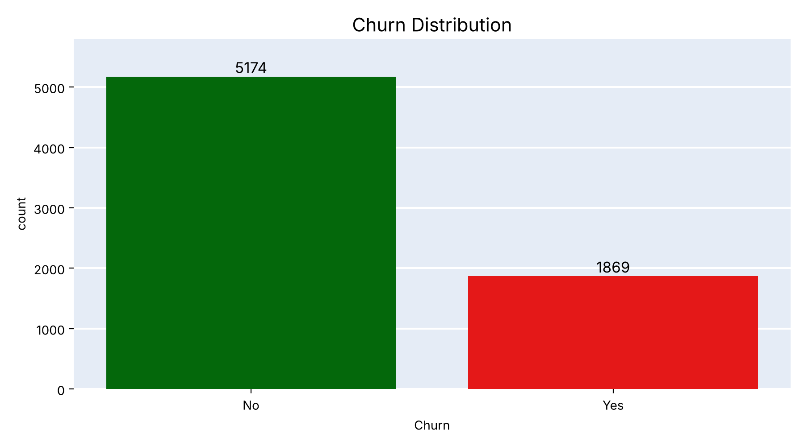

# # Telco Customer Churn: Exploratory Data Analysis

Exploratory data analysis (EDA) of the Telco Customer Churn dataset using Python.
The goal is to understand which customer characteristics are related to **churn** (customers who left the company).

## Dataset
- 7,043 customers and 21 columns
- Target column: `Churn` (Yes / No)
- Features: customer account info (tenure, contract, charges), services (internet, phone, streaming) and demographics
- Source: [IBM Telco Customer Churn dataset](https://github.com/IBM/telco-customer-churn-on-icp4d)

## What I did
1. Loaded and inspected the data (`info`, `describe`)
2. Cleaned the data: `TotalCharges` was stored as text because of 11 blank values, so I converted it to numeric and filled the blanks with `tenure * MonthlyCharges`
3. Explored the target variable (count plot, pie chart)
4. Explored numerical features (histograms, KDE, ECDF)
5. Explored categorical features (count plots)
6. Compared numerical features between churned and retained customers (box, violin, strip and swarm plots)

## Key findings
- About 26.5% of customers churned, so the target is imbalanced
- Churned customers have a much shorter tenure (median 10 months vs 38 months)
- Churned customers pay more per month (median about 79.65 vs 64.43)
- Month-to-month contracts have a much higher churn rate (about 42.7%) than two-year contracts (about 2.8%)

## Tools
Python, pandas, NumPy, Matplotlib, Seaborn, Plotly

## Files
- `churn_customer.ipynb`: the analysis notebook
- `Telco-Customer-Churn.csv`: the dataset

## How to run
```bash
pip install pandas numpy matplotlib seaborn plotly jupyter
jupyter notebook
```
Open the notebook and run all cells. Keep the CSV file in the same folder as the notebook.

## Note
The interactive Plotly chart does not render on GitHub. Run the notebook locally to see it.telco-customer-churn-eda
Exploratory data analysis of Telco customer churn using Python, pandas, seaborn and plotly

